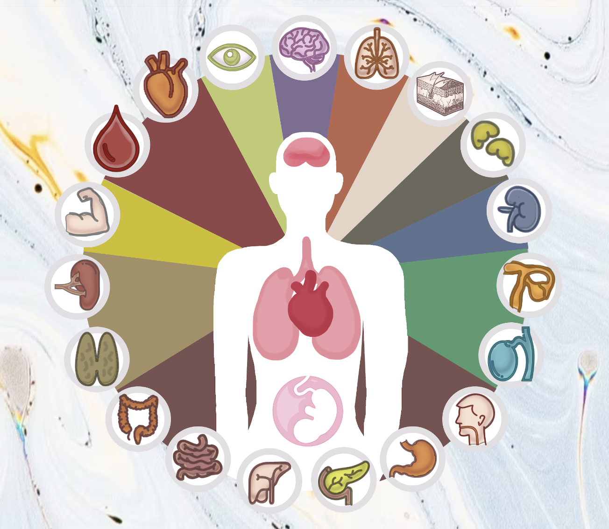

#### Dylan Renard
#### Professor Proschan & Professor Nason
#### JHU Biostatistics
#### June 8th, 2025

# Homework 3
This file explores creating stacked normal distribution plots, calculating probabilities in normal distributions, covid simulation of events simulating a binomial distribution as well as problems from the Textbook. All internet resources are cited in APA format at the end of this PDF document.

## Part 1: Cholesterol Dataset (Normal Distribution)

#### Q1: Probability Histogram
Make a histogram of the total cholesterol readings in this dataset, with the y-axis equal to the probability of being in each bar (not the frequency). Estimate the mean and standard deviation of this normal distribution. Give the estimates of these parameters, super-impose a normal distribution with that mean and SD on the histogram.
```{r}
# Load necessary library
if (!require("ggplot2")) install.packages("ggplot2", dependencies = TRUE)

# Only read in the dataset if it hasn't been loaded yet
if (!exists("chol_data")) {
  chol_data <- read.csv("cholesterol.txt")
  cat("Data loaded.\n")
} else {
  cat("Using previously loaded data.\n")
}

# Histogram with normal curve

# Extract Total Cholesterol column
chol <- chol_data$TOTCHOL

# Calculate mean and standard deviation
chol_mean <- mean(chol)
chol_sd <- sd(chol)

# Plot histogram with probability density
hist(chol,
     probability = TRUE,
     col = "skyblue",
     main = "Histogram of Total Cholesterol with Normal Curve",
     xlab = "Total Cholesterol",
     ylab = "Probability Density",
     border = "black")

# Overlay normal distribution curve
curve(dnorm(x, mean = chol_mean, sd = chol_sd),
      col = "red", lwd = 2, add = TRUE)

# Output stats
cat("Mean Total Cholesterol:", chol_mean, "\n")
cat("Standard Deviation:", chol_sd, "\n")

```

#### Q2: Stacked Histogram
Create a new variable that is a standardized version of total cholesterol by subtracting off the mean and dividing by the standard deviation. Make another histogram, this time of the standardized data. Superimpose a standard normal curve (“standard normal”: mean=0, SD=1)
```{r}
# Standardize Total Cholesterol and plot

# Only compute standardized values if they don't already exist
if (!"chol_std" %in% names(chol_data)) {
  # Standardize the data: Z = (X - mean) / SD
  chol_data$chol_std <- (chol_data$TOTCHOL - chol_mean) / chol_sd
  cat("Standardized cholesterol values added to dataset.\n")
} else {
  cat("Standardized cholesterol already exists.\n")
}

# Extract standardized values
chol_std <- chol_data$chol_std

# Plot histogram of standardized values
hist(chol_std,
     probability = TRUE,
     col = "lightgreen",
     main = "Histogram of Standardized Cholesterol (Z-scores)",
     xlab = "Z-score",
     ylab = "Probability Density",
     border = "black")

# Overlay standard normal curve (mean = 0, sd = 1)
curve(dnorm(x, mean = 0, sd = 1),
      col = "blue", lwd = 2, add = TRUE)

# Optional: Print a few sample Z-scores
cat("Example standardized values:\n")
print(head(chol_std, 5))
```

#### Q3: P(x >=240)
The American Heart Association (previously) defined “High (Total) Cholesterol” as 240 or above. What proportion of the people in this dataset have total cholesterol of 240 or above?
```{r}
# PART 3: Proportion with high cholesterol

# Only compute if not already calculated
if (!exists("high_chol_prop")) {
  high_chol_count <- sum(chol_data$TOTCHOL >= 240)
  total_count <- nrow(chol_data)
  high_chol_prop <- high_chol_count / total_count

  cat("Number of people with cholesterol ≥ 240:", high_chol_count, "\n")
  cat("Total number of people:", total_count, "\n")
  cat("Proportion with high cholesterol:", round(high_chol_prop, 4), "\n")
} else {
  cat("Proportion with high cholesterol already computed.\n")
}
```
#### Q4: Imagine you wanted to compare the population from which this sample is drawn to a different population, in which it is well-documented that 10% of people have total cholesterol of 240 or above.

#### a) Thought question about True Population Metrics and conditional probability P(x=33)
If the true rate of high cholesterol in this population were 10%, what is the probability that you would see exactly as many people with high cholesterol as you saw here? (hint, you don’t need to use the dataset to answer this)
We now want to assess the probability of observing **exactly 33 individuals** with high cholesterol (defined as total cholesterol ≥ 240) in a sample of 453, under the assumption that the true population rate is 10%.

This is a binomial probability problem, modeled as:

- **n = 453** (sample size)  
- **x = 33** (observed high cholesterol count)  
- **p = 0.10** (true population proportion)

We use the `dbinom()` function to compute:

```{r}
# Parameters
n <- 453
x <- 33
p <- 0.10

# Compute exact binomial probability
p_exact <- dbinom(x, size = n, prob = p)
p_exact
```


#### b)  Thought question about True Population Metrics and conditional probability P(x >=33)
If the true rate of high cholesterol in this population were 10%, what is the probability that you would see at least as many people with high cholesterol as you saw here? (hint, you don’t need to use the dataset to answer this)

To evaluate how surprising our observed result is, we calculate the probability of observing **33 or more** individuals with high cholesterol in a sample of 453, **assuming the true population rate is 10%**.

This is the cumulative probability of the upper tail of the binomial distribution:

- **n = 453** (sample size)  
- **x = 33** (observed count)  
- **p = 0.10** (true population rate)

We compute this using:

```{r}
# Parameters
n <- 453
x <- 33
p <- 0.10

# Probability of seeing 33 or more cases
p_at_least <- 1 - pbinom(x - 1, size = n, prob = p)
p_at_least
```


## Part 2: Covid Simulation
Read the document on Simulations in R in module 3, about for loops. Let’s pretend we planning a covid-19 vaccine study, and need to think about how many covid-19 infections we might see during the course of the trial. Assume the true incidence is 5% ; that is, if we looked at the whole population, 5% of people will get infected with covid-19 during the study follow-up. Use the examples in the simulation document to do 3 simulations; each simulation should have 1,000 repetitions:


#### Q1: Make a histogram of how many infections we can expect if we follow 10 people for the course of the trial.
```{r}
# Load ggplot2 if not already loaded
if (!require("ggplot2")) install.packages("ggplot2", dependencies = TRUE)
library(ggplot2)

# Parameters
set.seed(123)
n_sim <- 1000
size_1 <- 10
p_inf <- 0.05

# Simulate infections
sim_10 <- rbinom(n = n_sim, size = size_1, prob = p_inf)
df_10 <- data.frame(infections = sim_10)

# Compute mean
mean_10 <- mean(sim_10)

# Plot with ggplot2
ggplot(df_10, aes(x = infections)) +
  geom_bar(fill = "#69b3a2", color = "black", width = 0.9) +
  geom_vline(xintercept = mean_10, color = "red", linetype = "dashed", linewidth = 1.2) +
  annotate("text", x = mean_10 + 0.3, y = max(table(sim_10)) * 0.9,
           label = paste("Mean:", round(mean_10, 2)),
           color = "red", hjust = 0) +
  labs(title = "Simulated COVID-19 Infections (n = 10, 1,000 Trials)",
       subtitle = "Red dashed line shows the mean",
       x = "Number of Infections in Trial",
       y = "Count of Trials") +
  theme_minimal(base_size = 14)
```

#### Q2: Make a histogram of how many infections we can expect if we follow 100 people for the course of the trial.
```{r}
# Load ggplot2 if not already loaded
if (!require("ggplot2")) install.packages("ggplot2", dependencies = TRUE)
library(ggplot2)

# Parameters
set.seed(123)
n_sim <- 1000
size_2 <- 100
p_inf <- 0.05

# Simulate infections
sim_100 <- rbinom(n = n_sim, size = size_2, prob = p_inf)
df_100 <- data.frame(infections = sim_100)

# Compute mean
mean_100 <- mean(sim_100)

# Plot
ggplot(df_100, aes(x = infections)) +
  geom_histogram(binwidth = 1, fill = "#FF9999", color = "black") +
  geom_vline(xintercept = mean_100, color = "red", linetype = "dashed", linewidth = 1.2) +
  annotate("text", x = mean_100 + 1, y = max(table(sim_100)) * 0.9,
           label = paste("Mean:", round(mean_100, 2)),
           color = "red", hjust = 0) +
  labs(title = "Simulated COVID-19 Infections (n = 100, 1,000 Trials)",
       subtitle = "Distribution of infections per trial",
       x = "Number of Infections",
       y = "Number of Simulations") +
  theme_minimal(base_size = 14)
```
#### Q3: Make a histogram of how many infections we can expect if we follow 1,000 people for the course of the trial.
```{r}
# Load ggplot2 if needed
if (!require("ggplot2")) install.packages("ggplot2", dependencies = TRUE)
library(ggplot2)

# Parameters
set.seed(123)
n_sim <- 1000
size_3 <- 1000
p_inf <- 0.05

# Simulate infections
sim_1000 <- rbinom(n = n_sim, size = size_3, prob = p_inf)
df_1000 <- data.frame(infections = sim_1000)

# Compute mean
mean_1000 <- mean(sim_1000)

# Plot
ggplot(df_1000, aes(x = infections)) +
  geom_histogram(binwidth = 5, fill = "#FDB462", color = "black") +
  geom_vline(xintercept = mean_1000, color = "red", linetype = "dashed", linewidth = 1.2) +
  annotate("text", x = mean_1000 + 8, y = max(table(sim_1000)) * 0.9,
           label = paste("Mean:", round(mean_1000, 2)),
           color = "red", hjust = 0) +
  labs(title = "Simulated COVID-19 Infections (n = 1,000, 1,000 Trials)",
       subtitle = "Notice the bell curve shape forming",
       x = "Number of Infections",
       y = "Number of Simulations") +
  theme_minimal(base_size = 14)
```


#### Reflection Question: Briefly describe what you notice about the three histograms. Can you explain why?

As the sample size increased from 10 to 100 to 1,000, the histograms became progressively more symmetric and concentrated around the expected number of infections.

- For a sample size of **10**, the histogram was more irregular and skewed, with a wider relative spread.
- At **100**, the distribution became more bell-shaped and centered around the expected value of 5 infections.
- By **1,000**, the histogram closely resembled a normal distribution, centered around 50 infections, with much less relative variability.

This trend occurs because of two main reasons:
1. **Law of Large Numbers** – larger samples tend to produce more stable and accurate estimates of the true proportion.
2. **Central Limit Theorem** – the sum of many independent Bernoulli trials (like infection outcomes) tends to approximate a normal distribution as sample size increases.

Overall, the histograms demonstrate how increasing sample size leads to more predictable and less variable trial outcomes.

## Part 3: Chapter 7 Textbook Problems

#### Q10: Consider a group of seven individuals selected form the population of 65- to 74-year olds in the United States. The number of persons in this sample who suffer from diabetes is a binomial random variable with parameters n=7 and p=0.125

#### a) If you wish to make a list of the seven persons chosen, in how many ways can they be ordered?We are selecting 7 individuals and want to know **how many ways we can order them**.

This is a **permutation** problem, where order **does** matter.  
The number of ways to order $n$ individuals is given by:

- $n! = 7! = 7 \times 6 \times 5 \times 4 \times 3 \times 2 \times 1$

In R, we compute this using:

```{r}
factorial(7)
```

#### b) Without regard to order, in how many ways can you select 4 individuals from this group of 7?
Now we want to know how many ways we can **select 4 individuals** from a group of 7, **without regard to order**.

This is a **combination** problem, where order **does not** matter.  
The number of combinations is given by:

- $\binom{7}{4} = \dfrac{7!}{4!(7 - 4)!} = \dfrac{7!}{4! \cdot 3!}$

In R, we compute this with:

```{r}
choose(7, 4)
```


#### c) what is the probability that exactly two of the individuals in your sample suffer from diabetes?
We want to find the probability that **exactly 2 individuals** in a sample of 7 have diabetes,  
given that the diabetes rate in this population is 12.5% (i.e., $p = 0.125$).

Let:
- $X \sim \text{Binomial}(n = 7, p = 0.125)$  
- We want $P(X = 2)$

This probability can be calculated in R as:

```{r}
dbinom(2, size = 7, prob = 0.125)
```

#### d) what is the probability that four of them have diabetes?
We now want to calculate the probability that **exactly 4 out of 7 individuals** have diabetes,  
assuming the population diabetes rate is $p = 0.125$.

Let:
- $X \sim \text{Binomial}(n = 7, p = 0.125)$  
- We want $P(X = 4)$

We can compute this in R with:

```{r}
dbinom(4, size = 7, prob = 0.125)
```


#### Q12: According to the Behavioral Risk Factor Surveillance System, 58% of all Americans adhere to a sedentary lifestyle

#### a) If you selected repeated samples of size 12 from the US population, what would be the mean number of individuals per sample who do not exercise regularly? What would be the standard deviation?
We are told that 58% of Americans are sedentary. If we take repeated samples of 12 individuals, the number of sedentary individuals per sample follows a **binomial distribution**:

Let:  
- $n = 12$ (sample size)  
- $p = 0.58$ (probability of being sedentary)

We use the formulas for the binomial distribution:

- **Mean** ($\mu$) is:  
  $\mu = n \cdot p = 12 \cdot 0.58 = 6.96$

- **Standard Deviation** ($\sigma$) is:  
  $\sigma = \sqrt{n \cdot p \cdot (1 - p)} = \sqrt{12 \cdot 0.58 \cdot 0.42} \approx 1.71$

```{r}
# Parameters
n <- 12
p <- 0.58

# Mean and standard deviation
mean_sedentary <- n * p
sd_sedentary <- sqrt(n * p * (1 - p))

mean_sedentary
sd_sedentary
```

#### b) Suppose you select a sample of 12 individuals and find that 10 of them do not exercise regularly. Assuming the Surveillance System is correct, what is the probability you would have obtained results as bad or worse than those you observed?
In a sample of 12 individuals, we observe that **10 do not exercise regularly**.  
We want to find the probability of observing **10 or more sedentary individuals**, assuming the true sedentary rate is 58%.

Let:
- $X \sim \text{Binomial}(n = 12, p = 0.58)$  
- We want $P(X \geq 10)$

This can be calculated in R as:

```{r}
n <- 12
p <- 0.58

# Probability of observing 10 or more sedentary individuals
prob_10_or_more <- 1 - pbinom(9, size = n, prob = p)
prob_10_or_more
```

#### Q20: Framingham Study
In the Framingham study, serum cholesterol levels were measured for a large number of healthy males. The population was followed for 16 years. At the end of the time, the men were divided into 2 groups: those who had developed coronary disease and those who had not. The distributions of the initial serum cholesterol levels for each group were found to be approximately normal. Among individuals who eventually developed coronary disease, the mean serum cholesterol level was μd= 244 mg/100 ml and the standard deviation was σd=51 mg/100ml; for those who did not go on to develop the disease, the mean serum cholesterol was μnd= 219 mg/100 ml and the standard deviation was σd=41 mg/100ml.

#### a) Suppose that an initial serum cholesterol level of 260 mg/100ml was used to predict coronary heart disease. What is the probability of correctly predicting heart disease for a man who will go on to develop it?
```{r}
# Define parameters for those who develop heart disease
mu_d <- 244     # Mean cholesterol
sd_d <- 51      # Standard deviation
cutoff <- 260   # Prediction threshold

# Compute probability of correctly predicting disease (i.e., cholesterol > 260)
prob_correct_prediction <- 1 - pnorm(cutoff, mean = mu_d, sd = sd_d)

# Output result
prob_correct_prediction
```

If a man will go on to develop coronary heart disease, there's about a 38.75% chance that his cholesterol will be over 260 mg/100ml, and thus be correctly identified using this cutoff.


#### b) Using the cutpoint in (a), What is the probability of predicting heart disease for a man who will not go on to develop it?
```{r}
# Define parameters for those who do NOT develop heart disease
mu_nd <- 219    # Mean cholesterol (no disease)
sd_nd <- 41     # Standard deviation
cutoff <- 260   # Prediction threshold (same as part a)

# Compute probability of predicting disease (i.e., cholesterol > 260) for a healthy person
prob_false_positive <- 1 - pnorm(cutoff, mean = mu_nd, sd = sd_nd)

# Output result
prob_false_positive
```
There is about a 17.32% chance that a healthy man (no coronary disease) would be incorrectly predicted to have the disease using a 260 mg/100ml cutoff.
This is a false positive.

#### c) Using the cutpoint in (a), What is the probability of failing to predict heart disease for a man who will develop it?
```{r}
# Parameters for disease group
mu_d <- 244     # Mean cholesterol for disease group
sd_d <- 51      # Standard deviation
cutoff <- 260   # Same threshold as part (a)

# Compute probability of failing to predict disease (cholesterol <= 260)
prob_false_negative <- pnorm(cutoff, mean = mu_d, sd = sd_d)

# Output result
prob_false_negative
```

There is about a 61.25% chance of failing to predict heart disease (a false negative) for someone who will develop it, if 260 mg/100ml is used as the cutoff.

This complements part (a), where only 38.75% were correctly predicted.

#### d) What would happen to the probabilities of false positives and false negative errors if the cutoff point for predicting heart disease was lowered to 250 mg/100 ml?

```{r}
# Updated cutoff
cutoff_new <- 250

# Parameters for disease and non-disease groups
mu_d <- 244
sd_d <- 51

mu_nd <- 219
sd_nd <- 41

# Recalculate probabilities with new cutoff (250 mg/100ml)

# True positive rate: P(X > 250 | Disease)
true_positive_rate <- 1 - pnorm(cutoff_new, mean = mu_d, sd = sd_d)

# False positive rate: P(X > 250 | No Disease)
false_positive_rate <- 1 - pnorm(cutoff_new, mean = mu_nd, sd = sd_nd)

# Output both
true_positive_rate
false_positive_rate
```
True positive rate increases from ~38.75% (with cutoff at 260) to ~53.98% (with cutoff at 250):
→ More people who do have heart disease are now correctly identified.

False positive rate increases from ~17.32% to ~28.38%:
→ More healthy people are incorrectly flagged.

Conclusion: Lowering the cutoff improves sensitivity (fewer missed cases) but reduces specificity (more false alarms). This is the classic sensitivity–specificity tradeoff in diagnostic testing.

#### e) In ths population, does initial serum cholesterol appear to be useful for predicting coronary heart disease? Why or why not?

Initial serum cholesterol appears to be **somewhat useful**, but **not highly accurate** as a standalone predictor of coronary heart disease.

There is a clear difference between the two populations:

- Individuals who developed the disease had a mean cholesterol level of $\mu = 244$ with standard deviation $\sigma = 51$.
- Those who did **not** develop the disease had a mean of $\mu = 219$ and $\sigma = 41$.

However, the two distributions **overlap significantly**, which limits predictive accuracy. For example:

- With a threshold of **260 mg/100ml**, the **true positive rate** is only about **39%**, and the **false negative rate** is about **61%**.
- Lowering the threshold to **250 mg/100ml** increases sensitivity (true positives) to about **54%**, but also increases the **false positive rate** to nearly **28%**.

This tradeoff reflects the limitations of using serum cholesterol **in isolation**. While it provides **some discriminatory power**, its predictive value improves when combined with other risk factors (e.g., age, smoking, blood pressure) in a **multivariable risk model**.

Therefore, **serum cholesterol is helpful, but insufficient alone** for accurate prediction.

## Sources: 
Pagano, M., & Gauvreau, K. (2018). Principles of biostatistics / Marcello Pagano, Kimberlee Gauvreau. Duxbury Press.

R Core Team. (2024). R: A language and environment for statistical computing. https://www.r-project.org/


#### Thank you for reviewing and making it to the end of my work, in this assignment's signature end off I'd like to share a website we're using at work to find transcriptomic resources. Its part of the Human Transcriptomics Cell Atlas!


The Human Transcriptome Cell Atlas provides high-resolution gene expression data across tissues and cell types.




Explore more at: [https://www.htcatlas.org](https://www.htcatlas.org)