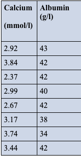

#### Dylan Renard
#### Professor Proschan & Professor Nason
#### JHU Biostatistics
#### May 25th 2025

# Homework 1
This file contains my responses for the takehome homework for unit 1 of the JHU Biostatistics course summer 2025 term. The file includes several written responses as well as box-plots. This includes answers to textbook problemns in Part 1 and statiscial plots made in R in Part 2.


## Part 1 (Textbook Problems)
### Q1 Continuous vs Discrete data types:

State whether each of the following observations is an example of discrete or continuous data. 
 
#### a. The number of suicides in the United States in a specific year. 

Discrete because this figure represents a coutable whole number, no fractions.

#### b. The concentration of lead in a sample of water. 

Continuous because this is measured on a contiuous scale with decimals.

#### c. The length of time that a cancer patient survives after diagnosis.

Continuous because the figure is measured in time units which can be fractional. 

#### d. The number of previous miscarriages an expectant mother has had.

Discrete because its coutable to whole numbers without fractions.

### Q2 Cardiovascular Visit durations:
The table below categorizes 10,614,000 office visits to cardiovascular disease specialists in the United States by the duration of each visit. A duration of 0 minutes implies that the patient did not have face-to-face contact with the specialist. 


#### The statement is made that office visits to cardiovascular disease specialists are most often between 16 and 30 minutes. Do you agree with this statement? Why or why not? 

The statement that most office visits to cardiovascular disease specialists are between 16 and 30 minutes is true. According to the provided data, this category has the highest number of visits—4,431 thousand, which exceeds all other duration categories. This indicates that the mode of the distribution falls within the 16–30 minute range.

However, it’s important to consider the generalizability of this finding. While the data provides insight into visit durations for this sample of US clinics, it may not fully represent other settings or populations. Studies on selection bias have highlighted that even in large-scale cohort designs, findings can be influenced by factors such as non-participation, loss to follow-up, or differences between those included and excluded from the study. In this case, factors like patient demographics, clinic capacity, or regional healthcare practices could influence the observed durations, thereby affecting the representativeness of these findings.

Thus, while the data supports the statement for this sample, caution should be exercised in generalizing the conclusion to the US as a whole or other countries without considering potential selection biases and differences across populations (Nohr & Liew, 2018).

#### Code Calculation/Validation
```{r question2, echo=TRUE, message=FALSE,warning=FALSE}
# load the data into a dataframe
duration <- c("0", "1-5", "6-10", "11-15", "16-30", "31-60", "61+")
visits <- c(390, 227, 1023, 3390, 4431, 968, 185)
cardio_data <- data.frame(Duration = duration, Visits = visits)

# Calcuate the mode (category with the max number of visits)
max_visits <- max(cardio_data$Visits)
mode_category <- cardio_data$Duration[which(cardio_data$Visits == max_visits)]

# Print the mode
print(paste0("The mode (most frequent duration) is: ", mode_category, " minutes"))

# Create a bar chart
library(ggplot2)
ggplot(cardio_data, aes(x = Duration, y = Visits)) +
  geom_bar(stat = "identity", fill = "skyblue") +
  labs(title = "Number of Office Visits by Duration",
       x = "Visit Duration (minutes)",
       y = "Number of Visits (thousands)") +
  theme_minimal()

# Show the summary Table
knitr::kable(cardio_data, caption = "Summary of Office Visits by Duration")
```


### Q3 Vitamin D intoxication across subgroups
In Massachusetts, eight individuals experienced an unexplained episode of vitamin D intoxication that required hospitalization; it was thought that these unusual occurrences might be the result of excessive supplementation of dairy milk. Blood levels of calcium and albumin--a type of protein--for each subject at the time of hospital admission are provided below. 



#### (a) Find the mean, median, standard deviation, and range of the recorded calcium levels,  
```{r question3, echo=TRUE, message=FALSE,warning=FALSE}
# Calcium levels 
calcium <- c(2.92, 3.84, 2.37, 2.99, 2.67, 3.17, 3.74, 3.44)

# Mean
mean_calcium <- mean(calcium)

# Median
median_calcium <- median(calcium)

# Standard deviation
sd_calcium <- sd(calcium)

# Range
range_calcium <- range(calcium)
range_value <- diff(range_calcium) # Max - min

# Output
output <- c(
  paste0("Mean Calcium: ", round(mean_calcium, 2), " mmol/L"),
  paste0("Median Calcium: ", round(median_calcium, 2), " mmol/L"),
  paste0("Standard Deviation Calcium: ", round(sd_calcium, 2), " mmol/L"),
  paste0("Range Calcium: ", round(range_value, 2), " mmol/L (", 
         round(range_calcium[1], 2), "-", round(range_calcium[2], 2), ")")
)
print(output)


```


#### (b) Compute the mean, median, standard deviation, and range of the given albumin levels. 
```{r}
# Albumin levels
albumin <- c(43, 42, 42, 40, 42, 38, 34, 42)

# Summary statistics
mean_albumin <- mean(albumin)
median_albumin <- median(albumin)
sd_albumin <- sd(albumin)
range_albumin <- range(albumin)
range_value_albumin <- diff(range_albumin)

# Output results
output_albumin <- c(
  paste0("Mean Albumin: ", round(mean_albumin, 2), " g/L"),
  paste0("Median Albumin: ", round(median_albumin, 2), " g/L"),
  paste0("Standard Deviation Albumin: ", round(sd_albumin, 2), " g/L"),
  paste0("Range Albumin: ", round(range_value_albumin, 2), " g/L (", 
         range_albumin[1], "-", range_albumin[2], ")")
)
print(output_albumin)
```


## Part 2 R-Plotting

### Q4 Low birth weight box plot.
The percentages of low birth weight infants in various countries around the world are contained in the data set unicef on the webpage (or the textbook CD). The measurements themselves are saved under the Variable lowbwt. 

#### (a) Construct a boxplot for the percentages of low birth weight infants. 
```{r question4, echo=TRUE, message=FALSE, warning=FALSE}
# Load the data from a TXT file
unicef_data <- read.table("unicef-1.txt", header=TRUE, sep=",", stringsAsFactors=FALSE)

# View the structure
str(unicef_data)

# Remove missing values (NA) for lowbwt
lowbwt_data <- na.omit(unicef_data$lowbwt)

# Create a boxplot
boxplot(lowbwt_data,
        main = "Boxplot of Low Birth Weight Percentages",
        xlab = "Low Birth Weight (%)",
        col = "lightblue",
        horizontal = TRUE)
```

#### (b) Do the data appear to be skewed? If so, are they skewed to the right or to the left? 
The boxplot of low birth weight percentages shows a right-skewed (positively skewed) distribution. This is evident from the longer whisker on the upper end of the boxplot and the presence of higher outliers (countries with unusually high low birth weight percentages). The majority of the data is concentrated toward the lower end (with the median closer to the bottom of the box), while a few countries have substantially higher rates of low birth weight. This indicates that most countries have relatively low lowbwt values, but a small number of countries have extreme high values driving the skewness.


#### (c) Do the data contain any outlying observations? 
```{r}
```{r question4c, echo=TRUE, message=FALSE, warning=FALSE}
# Load the data
unicef_data <- read.table("unicef-1.txt", header=TRUE, sep=",", stringsAsFactors=FALSE)

# Filter to complete cases for lowbwt
lowbwt_data <- unicef_data[!is.na(unicef_data$lowbwt), ]

# Calculate summary statistics and IQR
q1 <- quantile(lowbwt_data$lowbwt, 0.25)
q3 <- quantile(lowbwt_data$lowbwt, 0.75)
iqr <- q3 - q1
lower <- q1 - 1.5 * iqr
upper <- q3 + 1.5 * iqr
mean_val <- mean(lowbwt_data$lowbwt)

# Prepare labeled summary with explanations
labels <- c("Minimum", "1st Quartile (Q1)", "Median (Q2)", "Mean", "3rd Quartile (Q3)", "Maximum", "IQR")
values <- c(round(min(lowbwt_data$lowbwt), 2),
            round(q1, 2),
            round(median(lowbwt_data$lowbwt), 2),
            round(mean_val, 2),
            round(q3, 2),
            round(max(lowbwt_data$lowbwt), 2),
            round(iqr, 2))
explanations <- c("(Lowest observed low birth weight)",
                  "(25% of data below this value)",
                  "(Middle value of the data)",
                  "(Average low birth weight)",
                  "(75% of data below this value)",
                  "(Highest observed low birth weight)",
                  "(Spread of middle 50% of data)")
summary_output <- paste(labels, ": ", values, "% ", explanations, sep = "")
cat("Summary Statistics:\n", paste(summary_output, collapse = "\n"), "\n\n")

# Identify outlier rows (countries with extreme values)
outliers <- lowbwt_data[lowbwt_data$lowbwt < lower | lowbwt_data$lowbwt > upper, ]

# Print outlier countries and values
if(nrow(outliers) > 0){
  cat("Outliers Detected:\n", paste(outliers$Nation, ": ", outliers$lowbwt, "%", sep=""), sep="\n")
} else {
  cat("No outliers detected.\n")
}
```


### Q5 Fitness dataset Histogram and Boxplots.
.Using the “Fitness” data set (available on the class webpage), create: 

#### A histogram and boxplot of Resting Pulse (RstPulse) for everyone in the sample  
```{r question5-restingpulse, echo=TRUE, message=FALSE, warning=FALSE}
# Load data from Fitness-1.txt
fitness_data <- read.table("Fitness-1.txt", header=TRUE, sep=",", stringsAsFactors=FALSE)

# Histogram of Resting Pulse
hist(fitness_data$RstPulse,
     main = "Histogram of Resting Pulse",
     xlab = "Resting Pulse (beats per minute)",
     col = "skyblue",
     border = "black")

# Boxplot of Resting Pulse
boxplot(fitness_data$RstPulse,
        main = "Boxplot of Resting Pulse",
        xlab = "Resting Pulse (beats per minute)",
        col = "skyblue",
        horizontal = TRUE)
```

#### Separate histograms of Resting Pulse for men and women.
```{r question5-histogram-sex-side, echo=TRUE, message=FALSE, warning=FALSE}
# Load data from Fitness-1.txt
fitness_data <- read.table("Fitness-1.txt", header=TRUE, sep=",", stringsAsFactors=FALSE)

# Set up side-by-side plotting
par(mfrow = c(1, 2))

# Histogram for Women
hist(fitness_data$RstPulse[fitness_data$Sex == "F"],
     main = "Resting Pulse for Women",
     xlab = "Resting Pulse (bpm)",
     col = "pink",
     border = "black")

# Histogram for Men
hist(fitness_data$RstPulse[fitness_data$Sex == "M"],
     main = "Resting Pulse for Men",
     xlab = "Resting Pulse (bpm)",
     col = "lightblue",
     border = "black")
```

#### One plot with boxplots for men and women side by side  
```{r question5-boxplot-sex-horizontal, echo=TRUE, message=FALSE, warning=FALSE}
# Load data from Fitness-1.txt
fitness_data <- read.table("Fitness-1.txt", header=TRUE, sep=",", stringsAsFactors=FALSE)

# Create horizontal boxplot of RstPulse by Sex
boxplot(RstPulse ~ Sex,
        data = fitness_data,
        main = "Boxplot of Resting Pulse by Sex",
        ylab = "Sex",
        xlab = "Resting Pulse (bpm)",
        col = c("pink", "lightblue"),
        horizontal = TRUE)
```

#### A scatterplot of Oxygen uptake (Oxy) and Weight.  
```{r question5-scatterplot-oxy-weight-trend, echo=TRUE, message=FALSE, warning=FALSE}
# Load data from Fitness-1.txt
fitness_data <- read.table("Fitness-1.txt", header=TRUE, sep=",", stringsAsFactors=FALSE)

# Scatterplot
plot(fitness_data$Weight, fitness_data$Oxy,
     main = "Scatterplot of Oxygen Uptake vs Weight",
     xlab = "Weight (kg)",
     ylab = "Oxygen Uptake (ml/min)",
     pch = 19,
     col = "blue")

# Linear model
model <- lm(Oxy ~ Weight, data = fitness_data)
abline(model, col="red", lwd=2)

# Extract slope and intercept
slope <- coef(model)[2]
intercept <- coef(model)[1]
equation <- paste0("y = ", round(slope, 2), "x + ", round(intercept, 2))

# Calculate R-squared
r2 <- summary(model)$r.squared

# Add equation and R-squared text
text(x = max(fitness_data$Weight)*0.7, 
     y = max(fitness_data$Oxy)*0.9, 
     labels = paste(equation, "\nR² = ", round(r2, 3)),
     col = "red", cex=1.1)
```


#### (a) What is the median Resting Pulse overall?
```{r question5-median-rstpulse, echo=TRUE, message=FALSE, warning=FALSE}
# Load data
fitness_data <- read.table("Fitness-1.txt", header=TRUE, sep=",", stringsAsFactors=FALSE)

# Compute median of Resting Pulse (RstPulse)
median_rstpulse <- median(fitness_data$RstPulse, na.rm=TRUE)

# Print result
cat("The median Resting Pulse (RstPulse) across the sample is:", median_rstpulse, "bpm\n")
```

#### (b) For Women?
```{r question5-median-rstpulse-women, echo=TRUE, message=FALSE, warning=FALSE}
# Load data
fitness_data <- read.table("Fitness-1.txt", header=TRUE, sep=",", stringsAsFactors=FALSE)

# Compute median Resting Pulse for Women
median_rstpulse_women <- median(fitness_data$RstPulse[fitness_data$Sex == "F"], na.rm=TRUE)

# Print result
cat("The median Resting Pulse for women is:", median_rstpulse_women, "bpm\n")
```

#### (c) For Men?
```{r question5-median-rstpulse-men, echo=TRUE, message=FALSE, warning=FALSE}
# Load data
fitness_data <- read.table("Fitness-1.txt", header=TRUE, sep=",", stringsAsFactors=FALSE)

# Compute median Resting Pulse for Men
median_rstpulse_men <- median(fitness_data$RstPulse[fitness_data$Sex == "M"], na.rm=TRUE)

# Print result
cat("The median Resting Pulse for men is:", median_rstpulse_men, "bpm\n")
```

#### (d) Is the Overall mean Resting Pulse bigger or smaller than the Overall median Resting Pulse?
```{r question5-compare-mean-median, echo=TRUE, message=FALSE, warning=FALSE}
# Load data
fitness_data <- read.table("Fitness-1.txt", header=TRUE, sep=",", stringsAsFactors=FALSE)

# Calculate mean and median
mean_rstpulse <- mean(fitness_data$RstPulse, na.rm=TRUE)
median_rstpulse <- median(fitness_data$RstPulse, na.rm=TRUE)

# Print results and comparison
cat("Mean Resting Pulse:", round(mean_rstpulse, 2), "bpm\n")
cat("Median Resting Pulse:", round(median_rstpulse, 2), "bpm\n")

if(mean_rstpulse > median_rstpulse){
  cat("The mean Resting Pulse is greater than the median Resting Pulse.\n")
} else if(mean_rstpulse < median_rstpulse){
  cat("The mean Resting Pulse is smaller than the median Resting Pulse.\n")
} else {
  cat("The mean and median Resting Pulse are equal.\n")
}
```
#### (e) What does this suggest about the shape of the distribution?
If the mean Resting Pulse is greater than the median Resting Pulse, this suggests that the distribution of RstPulse is right-skewed (positively skewed). In such a distribution, the longer tail on the right side pulls the mean higher than the median. This indicates that while most participants have lower resting pulse rates, a few individuals with exceptionally high resting pulses are increasing the mean. Conversely, if the mean is smaller than the median, the distribution would be left-skewed (negatively skewed), suggesting a tail on the lower end. However, in this case, given typical pulse data and the expectation from most physiological datasets, it’s likely that the data is right-skewed, driven by a few high outliers.

#### (f) Which gender has a larger inter-quartile Range (IQR) for Resting Pulse?


```{r question5-iqr-gender, echo=TRUE, message=FALSE, warning=FALSE}
# Load data
fitness_data <- read.table("Fitness-1.txt", header=TRUE, sep=",", stringsAsFactors=FALSE)

# Calculate IQR for women
iqr_women <- IQR(fitness_data$RstPulse[fitness_data$Sex == "F"], na.rm=TRUE)

# Calculate IQR for men
iqr_men <- IQR(fitness_data$RstPulse[fitness_data$Sex == "M"], na.rm=TRUE)

# Print results and comparison
cat("IQR of Resting Pulse for Women:", round(iqr_women, 2), "bpm\n")
cat("IQR of Resting Pulse for Men:", round(iqr_men, 2), "bpm\n")

if(iqr_women > iqr_men){
  cat("Women have a larger IQR for Resting Pulse.\n")
} else if(iqr_women < iqr_men){
  cat("Men have a larger IQR for Resting Pulse.\n")
} else {
  cat("Men and Women have the same IQR for Resting Pulse.\n")
}
```

#### (g) Does there seem to be a relationship between Weight and Oxygen uptake? Briefly explain your answer.
Based on the scatterplot of Oxygen Uptake (Oxy) vs Weight, there appears to be a moderate positive relationship between the two variables. As weight increases, oxygen uptake also tends to increase, suggesting that heavier individuals may generally have higher oxygen consumption during physical activity. The linear trendline in the scatterplot, with its upward slope, indicates this positive association. However, the R² value is not particularly high, which implies that while weight contributes to oxygen uptake levels, it does not explain all of the variation. Other factors such as fitness level, age, and gender likely also play a role. Overall, while a positive association exists, it is not particularly strong or definitive and should be interpreted alongside other variables that influence oxygen uptake.


## Sources:

Nohr, E. A., & Liew, Z. (2018). How to investigate and adjust for selection bias in cohort studies. Acta obstetricia et gynecologica Scandinavica, 97(4), 407–416. https://doi.org/10.1111/aogs.13319 


#### Thank you for reiewing my work, please enjoy this figure of a motor protein for making it to the end
