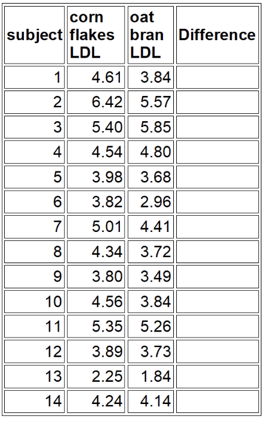

#### Dylan Renard
#### Professor Proschan & Professor Nason
#### JHU Biostatistics
#### June 23rd, 2025

# Homework 6
In this assignment, we will compare means between paired and independent groups using t-tests to asses changes in immune cell percentages over time and differences based on IL-2 exposure. We will also analyze cholesterol and bone density data from clinical studies to evaluate the effects of dietary and maternal behaviors on health outcomes.


## Q1: 
Last time, we tested for a difference between 4 and 72 hour CD8 data by creating a new variable that summarized the difference for each person. You can do the same test using the “paired=T” choice, without creating this variable. Compare the 4 hour and 72 hour CD8 using a paired design.

```{r}
# load the data
blood <- read.csv("Blood over time.csv")

# Extract CD8 measurements at 4hrs and 72hrs
cd8_4h <- subset(blood, Hours.post.draw == 4)[, c("ID", "CD8.xCD127")]
cd8_72h <- subset(blood, Hours.post.draw == 72)[, c("ID", "CD8.xCD127")]

# Rename our columns for clairty
colnames(cd8_4h)[2] <- "CD8_4h"
colnames(cd8_72h)[2] <- "CD8_72h"

# Merge the two datasets by subject ID to pair the measurements
paired_data <- merge(cd8_4h, cd8_72h, by = "ID")

# paired t-test
t.test(paired_data$CD8_4h, paired_data$CD8_72h, paired = "TRUE")
```

In conclusion, we found a statistically ignificant decrease in the percentage of CD8+ T cells expressing CD127 between 4 and 72 hours after each blood collection (paired t-test, p=0.00017). On average, CD8+CD127+ expression dropped by 3.66% percentage points over this time period, with a 95% confidence interval ranging from 1.93% to 5.39%. These results support concerns that prolonged storage negatively affects CD8 marker expression, potentially impacting downstream experimental reliability.

## Q2:
Some of the individuals in the sample had taken IL-2 in the recent past when their blood was drawn; others had not. Do a t-test to answer the question as to whether there is a difference in the CD4% between people who have and have not taken IL-2, based on the 4 hour data. Write a one-sentence conclusion (including the p-value) of the results of the test, the way you might include it in a science paper. Also give the 95% confidence interval for the difference in means. Do this:

```{r}
# Load data and do pre-processing
blood2 <- read.csv("Blood over time.csv")

# Filter for 4-hour measurements only
cd4_4h <- subset(blood2, Hours.post.draw ==4)

# Group data by IL-2 status
yes_group <- subset(cd4_4h, IL2 == "YES")$CD4.xCD127
no_group <- subset(cd4_4h, IL2 == "NO")$CD4.xCD127

```

### a) Assuming equal variances.
```{r}
# Unpaired t-test assuming equal variances
t.test(yes_group, no_group, var.equal = TRUE)
```


### b) Assuming unequal variances.
```{r}
# Unpaired t-test assuming unequal variances
t.test(yes_group, no_group, var.equal = FALSE)
```
### c) Minimum Sample Size threshold for a given Statistical power.
```{r}
# To detect a 5% difference with SD = 8%, 80% power, alpha = 0.5
# Install 'pwr' package if not already installed
if (!requireNamespace("pwr", quietly = TRUE)) {
  install.packages("pwr")
}
library(pwr)
pwr.t.test(d = 5 / 8, power = 0.80, sig.level = 0.05, type = "two.sample", alternative = "two.sided")
```

The researcher comes back to you a few weeks later and wants to design two new trials to address the same questions, with higher statistical power. How many subjects to answer the following question: Are there differences between people with/without a history of IL2? Assume that CD4% in both groups will be normally distributed with a standard deviation of 8%. How many people are needed PER GROUP in order to have 80% power to detect a difference of 5% or greater?


## Part 2 text book problems from Chapter 11

## Q3 Problem 5:
A crossover study was conducted to investigate whether oat bran cereal helps to lower cholesterol levels in hypercholesterolemic males. Fourteen such individuals were randomly placed on a diet that included either oat bran or corn flakes; after two weeks, their low-density lipoprotein (LDL) cholesterol levels were recorded. Each man was then switched to the alternative diet. After a second two-week period, the LDL cholesterol level of each individual was again recorded. The data from this study are shown below:



### a) Are the two samples paired or independent?

### b) What are the appropriate null and alternative hypotheses for a two-sided test

### c) Conduct the test at the 0.05 level of significance. What is the p-value?

### d) What do you conclude?

## Q4 Problem 8:
A study was conducted to determine whether an expectant mother's cigarette smoking has any effect on the bone mineral content of her otherwise healthy child. A sample of 77 newborns whose mothers smoked during pregnancy has mean bone mineral content x-bar1 = 0.098 g/cm and standard deviation s1 = 0.026 g/cm; a sample of 161 infants whose mothers did not smoke has mean x-bar2 = 0.095 g/cm and standard deviation s2 = 0.025 g/cm. Assume that the underlying population variances are equal.


### a) Are the two samples paired or independent?

### b) State the null and alternative hypotheses of the two-sided test.

### c) Conduct the test at the 0.05 level of significance. What do you conclude?


## Sources: 

Pagano, M., & Gauvreau, K. (2018). Principles of biostatistics / Marcello Pagano, Kimberlee Gauvreau. Duxbury Press.

#### Thank you for reviewing and making it to the end of my work, in this assignment's signature end off I'd like to share an exciting paper to come out of my company Bruker spatial biology. They explore new methods of cell typing classification in spatial biology samples. I hope one day to have a biostatistics level of understanding to build on work like this! Best, Dylan Renard.

