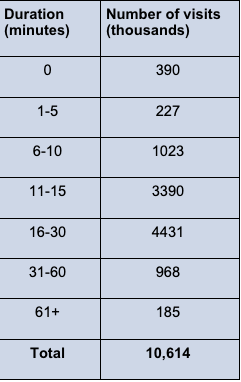

#### Dylan Renard
#### Professor Proschan & Professor Nason
#### JHU Biostatistics
#### May 25th 2025

# Homework 1
This file contains my responses for the takehome homework for unit 1 of the JHU Biostatistics course summer 2025 term. The file includes several written responses as well as box-plots. This includes answers to textbook problemns in Part 1 and statiscial plots made in R in Part 2.


For my first submission I will turn in a pdf of this file in addition to the Rmarkdown file. In future assignments, let me know if the PDF is sufficient. 


## Part 1 (Textbook Problems)
### Q1 Continuous vs Discrete data types:

State whether each of the following observations is an example of discrete or continuous data. 
 
#### a. The number of suicides in the United States in a specific year. 

Discrete because this figure represents a coutable whole number, no fractions.

#### b. The concentration of lead in a sample of water. 

Continuous because this is measured on a contiuous scale with decimals.

#### c. The length of time that a cancer patient survives after diagnosis.

Continuous because the figure is measured in time units which can be fractional. 

#### d. The number of previous miscarriages an expectant mother has had.

Discrete because its coutable to whole numbers without fractions.

### Q2 Cardiovascular Visit durations:
The table below categorizes 10,614,000 office visits to cardiovascular disease specialists in the United States by the duration of each visit. A duration of 0 minutes implies that the patient did not have face-to-face contact with the specialist. 



#### The statement is made that office visits to cardiovascular disease specialists are most often between 16 and 30 minutes. Do you agree with this statement? Why or why not? 

The statement that most office visits to cardiovascular disease specialists are between 16-30 mins is true. According to the provided data, this category has the highest number of visits-4,431 thousand, which is larger than any other category. Therefore, the mode of the distribution falls within the 16-30 minute range, making this statement accurate. 

#### Code Calculation/Validation
```{r question2, echo=TRUE, message=FALSE,warning=FALSE}
# load the data into a dataframe
duration <- c("0", "1-5", "6-10", "11-15", "16-30", "31-60", "61+")
visits <- c(390, 227, 1023, 3390, 4431, 968, 185)
cardio_data <- data.frame(Duration = duration, Visits = visits)

# Calcuate the mode (category with the max number of visits)
max_visits <- max(cardio_data$Visits)
mode_category <- cardio_data$Duration[which(cardio_data$Visits == max_visits)]

# Print the mode
cat("The mode (most frequent duration) is:", mode_category, "minutes\n")

# Create a bar chart
library(ggplot2)
ggplot(cardio_data, aes(x = Duration, y = Visits)) +
  geom_bar(stat = "identity", fill = "skyblue") +
  labs(title = "Number of Office Visits by Duration",
       x = "Visit Duration (minutes)",
       y = "Number of Visits (thousands)") +
  theme_minimal()

# Show the summary Table
knitr::kable(cardio_data, caption = "Summary of Office Visits by Duration")
```


### Q3 Vitamin D intoxication across subgroups
In Massachusetts, eight individuals experienced an unexplained episode of vitamin D intoxication that required hospitalization; it was thought that these unusual occurrences might be the result of excessive supplementation of dairy milk. Blood levels of calcium and albumin--a type of protein--for each subject at the time of hospital admission are provided below. 


#### (a) Find the mean, median, standard deviation, and range of the recorded calcium levels,  


#### (b) Compute the mean, median, standard deviation, and range of the given albumin levels. 

## Part 2 R-Plotting

### Q4 Low birth weight box plot.
The percentages of low birth weight infants in various countries around the world are contained in the data set unicef on the webpage (or the textbook CD). The measurements themselves are saved under the Variable lowbwt. 

#### (a) Construct a boxplot for the percentages of low birth weight infants. 

#### (b) Do the data appear to be skewed? If so, are they skewed to the right or to the left? 

#### (c) Do the data contain any outlying observations? 


### Q5 Fitness dataset Histogram and Boxplots.
.Using the “Fitness” data set (available on the class webpage), create: 

A histogram and boxplot of Resting Pulse (RstPulse) for everyone in the sample  

Separate histograms of Resting Pulse for men and women.  

One plot with boxplots for men and women side by side  

A scatterplot of Oxygen uptake (Oxy) and Weight.  


#### (a) What is the median Resting Pulse overall?

#### (b) For Women?

#### (c) For Men?

#### (d) Is the Overall mena Resting Pulse bigger or smaller than the Overall median Resting Pulse?

#### (e) What does this suggest about the shape of the distribution?

#### (f) Which gender has a larger inter-quartile Range (IQR) for Resting Pulse?

#### (g) Does there seem to be a relationship between Weight and Oxygen uptake? Briefly explain your answer.


## Sources:


